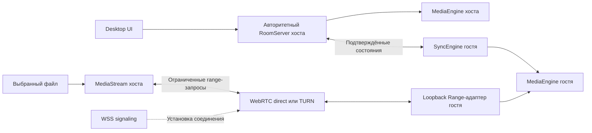

# Совместный видеоплеер: проект технического прототипа

Дата: 20.10.2026. Статус: архитектура утверждена пользователем 20.10.2026; Rust-ядро A реализовано, B/C/D остаются следующими подпроектами.

Источник требований: [PRD v1.0](../../requirements/2026-10-20-watch-together-prd.md).

Дополнение пользователя после утверждения: [схемы интерфейса и поведения](../../requirements/2026-10-20-interface-notes.md), [исходный PDF](../../requirements/2026-10-20-interface-supplement.pdf). Архитектуру не меняет; уточнения UI включаются в подпроекты B/C/D.

## 1. Цель и границы

Создать десктопное приложение для macOS и Windows: владелец открывает локальный фильм, приглашает друзей, они получают исходные видеоданные и смотрят с общим таймкодом без собственной копии файла и ручной настройки роутера. Громкость, аудиодорожка и субтитры индивидуальны; пауза, перемотка и базовая скорость общие.

Проект новый, поэтому применяется архитектурный путь Superpowers. Это проект первого этапа, а не заявление о готовности полного MVP. Первый этап должен проверить самые дорогие предположения до масштабирования интерфейса.

Приёмочный результат этапа: два компьютера в разных сетях, macOS ARM64 и Windows x64, воспроизводят один большой MKV; работают перемотка, независимый выбор встроенных дорожек, общий play/pause/seek/speed, подключение без настройки роутера и прекращение доступа после закрытия комнаты. Дополнительно проверяются MP4 и MOV. Сеть должна работать как при прямом соединении, так и при принудительной ретрансляции.

Полный MVP сохраняет требования PRD: 2–5 участников, два режима управления, горячие клавиши, внешние SRT/ASS, сохранение настроек, установщики и обновления. Расширенный UI, автообновление и релизная упаковка не входят в первый технический прототип. Аккаунты, чат, видеосвязь, облачное хранение и транскодирование исключены.

Проверка поставки входит уже в прототип: тестовый bundle запускается на чистых целевых ОС без отдельно установленного mpv, Rust или Node. Релизная подпись, notarization и updater остаются отдельным этапом.

## 2. Подходы и рекомендуемое решение

| Вариант | Преимущество | Цена и ограничение |
| --- | --- | --- |
| Tauri 2 + React/TypeScript + встроенный libmpv | Соответствует рекомендованному стеку PRD; Rust обслуживает локальные сервисы | Нужно доказать совместимость нативной видеоповерхности, WebView, GPU и fullscreen на обеих ОС |
| Qt 6 + libmpv | Предсказуемые средства нативного окна и видеоповерхности | Другой UI-стек, более сложная поставка Qt и отдельная проверка лицензирования |
| Внешний процесс mpv | Быстро проверяет декодирование, дорожки и Range | Отдельное окно не доказывает встраивание и не является целевым интерфейсом |

Предлагается Tauri 2 + React + TypeScript + Tailwind для оболочки и Rust для ядра. libmpv является отдельным адаптером за интерфейсом MediaEngine. Выбор оболочки предварительный: при провале нативной интеграции на целевых ОС решение пересматривается в пользу Qt; сетевой протокол и синхронизация от UI не зависят. Внешний mpv допустим только как диагностический инструмент.

## 3. Компоненты и границы доверия

- **MediaEngine**: загрузка, play/pause, seek, speed, позиции, метаданные, дорожки, субтитры, события декодера. Работает с native render surface, а не с HTML video, возможности которого не покрывают PRD.
- **RoomServer**: на устройстве хоста; авторитетное состояние, порядок команд, участники, права, лимиты, жизненный цикл.
- **MediaStream**: читает только выбранный открытый файл, обслуживает байтовые диапазоны без загрузки всего файла в RAM.
- **SyncEngine**: чистая логика часов, проекции позиции и коррекции; тестируется независимо от плеера и реальной сети.
- **Network**: signaling, peer identity, прямое соединение, relay fallback, переподключение. Не получает права самостоятельно менять состояние комнаты.
- **Desktop UI**: локальные действия и отображение состояния; общие команды всегда проходят проверку RoomServer, включая действия самого хоста.

Граница Tauri: минимальные capabilities, ограниченная CSP, отсутствие удалённого контента в привилегированном WebView и узкие типизированные IPC-команды. Имена участников, файлов и метаданные считаются недоверенными. Универсальные IPC для shell, чтения произвольного пути или произвольных URL не предоставляются; Rust повторно проверяет полномочия независимо от UI.

Предлагаемая структура следует PRD: `apps/desktop`, `crates/{media-engine,room-server,media-stream,sync-engine,network,shared-protocol}`, `services/{signaling,relay}`, `tests/{integration,network}`. Фактические пакеты создаются по мере реализации, без пустых заглушек готовности.

## 4. Видеоданные и соединение через интернет

HTTP Range — интерфейс чтения для libmpv; он не служит механизмом обхода NAT. На устройстве гостя небольшой HTTP-адаптер слушает только loopback на случайном порту. libmpv передаёт отдельный случайный токен в HTTP-заголовке; проверяются loopback-привязка и `Host`, широкий CORS не включается. Токен не включается в URL или журналы. Адаптер переводит запрос диапазона в запрос выбранному хосту; произвольные пути и URL от клиента не принимаются.

Предпочтительный транспорт для проверки — WebRTC DataChannel: ICE для прямого подключения, TURN для ретрансляции, DTLS для защиты данных в обоих случаях. WSS-signaling координирует установление соединения. TURN передаёт зашифрованные пакеты и не хранит файл. TURN — отдельная инфраструктурная служба; обычный WebSocket relay не заменяет TURN для WebRTC.

Управление комнатой использует отдельный логический канал от видео. PRD предлагает WebSocket для событий; в локальном ядре он допустим, но наружный WebSocket хоста также недоступен за NAT без туннеля. Предложение для прототипа — отдельный аутентифицированный DataChannel для общего состояния; это явное изменение предлагаемого PRD транспорта событий при сохранении его поведения. WSS используется для signaling. Если эксперимент вынудит перенести управление на WSS relay, потребуется отдельное решение о сквозной аутентификации: TLS до посредника не доказывает авторство хоста.

Диапазоны передаются чанками с идентификаторами запроса и смещением. Размер чанка ограничивается согласованным пределом DataChannel; реализуются backpressure, отмена ненужных запросов после seek, лимиты параллельных запросов и памяти. EOF, ошибки файла и разрыв транспорта различимы. Повторный запрос не должен возвращать байты от ранее выбранного фильма: используется идентификатор сессии mediaId.

Каналы управления и видео используют раздельные очереди и лимиты, но делят пропускную способность соединения. Отдельный DataChannel сам по себе не гарантирует низкую задержку команд под нагрузкой. При тестировании проверяется приоритет управления во время активной передачи. TURN/TLS через TCP 443 проверяется отдельно от UDP; прохождение любых корпоративных прокси не обещается.

Range-адаптер поддерживает `HEAD`, `GET`, один диапазон `bytes`, открытый конец и суффикс. Проверяются `206`, `Content-Range`, `Content-Length`, `Accept-Ranges`, `416`, границы файла, смещения свыше 4 ГиБ и переполнения арифметики. Multiple ranges отклоняются явно. Память ограничивается размером рабочего буфера, а не размером видео. На госте нет постоянной копии и дискового кэша по умолчанию.

Точный Rust WebRTC-стек выбирается при планировании реализации после проверки поддержки macOS/Windows, TURN и ограничений DataChannel. Это проверка осуществимости, а не обещание работающего NAT traversal до испытаний.

## 5. Приглашения, авторизация и отзыв

Короткий код — идентификатор поиска комнаты, не ключ доступа. Приглашение содержит отдельную криптографически случайную capability не менее 128 бит. Приглашение служит основанием для входа; хост выдаёт отдельную сессию участнику. Секреты не попадают в журналы, сообщения об ошибках и телеметрию. Для первого прототипа предлагается полноценная ссылка-приглашение. Вход только по короткому коду из PRD остаётся обязательным для MVP, но требует отдельного безопасного UX-решения; короткий код с дополнительным секретом был бы изменением UX и не считается согласованным требованием.

Предлагаемая модель доверия: signaling не является источником доверия к личности хоста. Переданная другом ссылка закрепляет ключ хоста; peer-соединение и оба логических канала связываются с этим ключом проверенным механизмом аутентификации, с защитой handshake от повторного использования. Точный механизм выбирается при планировании, собственная криптографическая схема не разрабатывается. Ключ, полученный исключительно из signaling, не принимается как независимое подтверждение. Медиа-запросы разрешены только активным сессиям участников и только для текущего mediaId. До аутентификации данные фильма не выдаются.

Хост может отозвать приглашение для новых входов, исключить конкретного участника или закрыть комнату. Исключение аннулирует его сессию и останавливает активные передачи; закрытие комнаты аннулирует все сессии, закрывает peer-соединения и локальный доступ к источнику. Уже доставленные данные нельзя отозвать с устройства участника; UI не обещает DRM.

В room-server максимум пять участников вместе с хостом. Лимиты команд, соединений, размеров сообщений и активных диапазонов применяются до дорогой обработки. Нет общего файлового сервера, обхода директорий или произвольного проксирования. URL loopback-адаптера не доступен через произвольный интерфейс; клиентские HTTP-запросы проверяются и локально. Политика mpv запрещает выполнение опасных команд и произвольную загрузку ресурсов из непроверенных удалённых плейлистов.

Loopback проверяет точный допустимый `Host` и токен на каждом `GET`/`HEAD`, не делает redirects; capability меняется при смене комнаты. libmpv запускается без пользовательских конфигураций и скриптов, без автоматического поиска соседних файлов; разрешены выбранный источник и явно выбранные внешние субтитры. Вложенные плейлисты, ссылки на другие файлы и непредусмотренные сетевые ресурсы отклоняются. Эти ограничения проверяются, а не предполагаются по конфигурации UI.

## 6. Общее состояние и синхронизация

Состояние содержит `roomId`, `mediaId`, `revision`, статус, базовую позицию, базовую скорость и момент фиксации на часах хоста. Позиция проецируется по монотонным часам, а не по изменяемым календарным часам. При обмене временными метками оцениваются RTT и смещение часов; задержанные выбросы не определяют оценку в одиночку.

Хост проверяет автора, полномочия, mediaId, формат и диапазоны значений команды. Только он присваивает следующую revision и рассылает подтверждённое состояние. Повторная доставка команды не должна повторять действие: используются идентификаторы команд. Запоздавшие состояния не отменяют более новые. При seek базовая позиция изменяется атомарно; при pause/speed сначала вычисляется текущая позиция.

Проверка позиции каждые 1–2 секунды. Начальные пороги из PRD: до 100 мс — без коррекции, 100–500 мс — временная небольшая коррекция скорости, свыше 500 мс — seek. После схода к цели возвращается глобальная базовая скорость; локальная коррекция не публикуется как новое общее значение.

Буферизация гостя по умолчанию не останавливает остальных. После восстановления гость получает свежий snapshot и синхронизируется с текущим таймкодом. При reconnect старая сессия не получает бессрочный доступ; права подтверждаются заново. Остановка хоста закрывает комнату, передачи роли нет.

Два режима управления: `everyone` и `host-only`. Изменять режим, исключать участников и отзывать приглашение может только хост. Громкость, mute, fullscreen, аудиодорожки и субтитры остаются локальными.

## 7. Интерфейс прототипа и ошибки

Минимальная оболочка: открыть файл, видеоповерхность, play/pause/seek/speed, выбор дорожек, создать комнату, скопировать приглашение, подключиться, показать статус участника и закрыть комнату. Для проверки политики нужны переключение режима управления и исключение участника. Полировка визуального дизайна следует после технических проверок.

Схема из PDF уточняет компоновку: имя файла слева сверху, участники справа, тёмная область видео с исходным aspect ratio, нижняя панель с позицией/длительностью и буфером. Панель появляется при движении указателя и скрывается во время просмотра. Кнопки ±5 s, pause, громкость, скорость, дорожки, субтитры и fullscreen находятся рядом с таймлайном. Это рабочая схема, а не утверждённые пиксельные размеры или финальная дизайн-система.

Ошибки представлены раздельно: неподдерживаемый кодек/декодер, недоступный файл, отказ авторизации, сеть/TURN, нехватка буфера и закрытая комната. Сбой транспорта не маскируется под ошибку видеодекодера. UI показывает фактическое состояние; не имитирует успешное подключение и воспроизведение.

## 8. Проверки и критерии решения о продолжении

| Область | Что доказываем | Где |
| --- | --- | --- |
| Авторитетное состояние | Порядок revision, дедупликация, права, атомарные seek/speed/pause | Автотесты Rust с управляемыми часами |
| HTTP Range | Точные байты, 206/416, начало/конец/суффикс, отмена, ограниченная память | Интеграционные тесты на Linux и целевых ОС |
| Безопасность | Без сессии нет видео; исключение/закрытие обрывает активный доступ; путь нельзя подменить | Негативные интеграционные тесты |
| Синхронизация | Пороговые коррекции, RTT/clock offset, старые сообщения, reconnect | Детерминированные тесты + отдельное измерение в реальной сети |
| libmpv и окно | MKV/MP4/MOV, дорожки, аппаратный декодер где доступен, fullscreen, resize/DPI, корректное закрытие | Реальные macOS ARM64 и Windows x64 |
| Передача | Другой компьютер получает исходные байты без своего файла; seek не требует полной загрузки | Два компьютера, разные сети |
| Relay fallback | Работает при запрещённом прямом пути; соединение защищено | Принудительный TURN и отдельный результат direct |
| Приёмка синхронности | Не более 250 мс между участниками при зафиксированных стабильных условиях | Реальное измерение позиции обоих декодеров; журнал условий и результатов |

Медиафикстуры должны быть небольшими и пригодными для распространения. Отдельно испытываются большой MKV, у которого индекс расположен неудобно для последовательного чтения, и MP4 с `moov` в конце. Проверка побайтового совпадения не заменяет декодирование; успешная сборка не заменяет проверку GPU и fullscreen. H.264, HEVC, VP9 и AV1 сохраняются как обязательный минимум MVP с фиксацией программного/аппаратного декодирования. ProRes и macOS Intel проверяются отдельно; аппаратная поддержка зависит от устройства.

Целевой критерий ≤250 мс подтверждается измерениями, а не настройками алгоритма. Для сетевых испытаний фиксируются ОС, версия сборки, кодек, битрейт, количество участников, RTT, потери, режим direct/relay и длительность. До прохождения проверок целевых ОС стек Tauri остаётся предварительным.

Предлагаемый воспроизводимый стенд, дополнительно к PRD: RTT не более 100 мс, потери не более 0,1%, полоса не ниже удвоенного суммарного битрейта потоков. После начальной буферизации измеряются приведённые к общему времени позиции обоих декодеров в течение 10 минут; после seek/reconnect возвращение к ≤250 мс ожидается за 5 секунд. Это параметры предлагаемой приёмки, не уже подтверждённые показатели. Fullscreen/window проверяется десятью переходами и переносом между дисплеями разного DPI.

Отрицательные проверки включают подмену SDP/ключа хоста и состояния, replay handshake, запрос без токена, прежнюю loopback capability, DNS rebinding и попытки медиадвижка прочитать невыбранный файл/сетевой ресурс. Это тесты контрактов, не утверждение о найденных уязвимостях существующего кода.

## 9. Среда и внешние зависимости

Текущая среда: Linux x86_64, Node.js/npm, Python и FFmpeg доступны. Rust/Cargo, CMake, libmpv, GTK3 и WebKitGTK в текущем экземпляре не обнаружены. Их установка и версии должны войти в план реализации; продуктовые зависимости пока не устанавливались.

Linux пригоден для сборки и тестов Rust-ядра, frontend и локальной интеграции при установке необходимых зависимостей. Он не подтверждает готовность macOS/Windows. Для завершения нативных проверок потребуются машины/раннеры этих ОС; неподписанная тестовая сборка не считается готовым релизом.

Signaling и TURN потребуют доступного сервиса и runtime-конфигурации. На стадии локальных тестов используются локальные тестовые службы. Прежде чем запрашивать ключи, проверяются существующие привязки окружения; значения секретов не записываются в репозиторий. Облачные сервисы не создаются и не публикуются без конкретного согласованного действия.

Signaling ограничивает попытки входа и срок жизни приглашений. TURN использует краткоживущие credentials, ограниченные allocations и квоты трафика; анонимная ретрансляция запрещена. Постоянный общий секрет TURN не встраивается в desktop-сборку. Проверка отсутствия злоупотреблений инфраструктурой не заменяется лимитом пяти участников локальной комнаты.

Нужно определить лицензии конкретных сборок mpv/FFmpeg и транзитивных библиотек перед распространением. Подпись, notarization, installer и updater принадлежат релизному этапу; прототип не означает прохождения этих требований.

## 10. Решение, предлагаемое на согласование

Начать с технического прототипа на Tauri 2 + libmpv и независимого Rust-ядра, сохранить возможность перехода на Qt после проверки нативного рендера. Реализовывать исходные байтовые диапазоны через локальный адаптер, отдельно проверив WebRTC direct/TURN и выбор транспорта событий. Не масштабировать остальные функции MVP до доказательства основного сценария.

После согласования этого документа следующий артефакт по Superpowers — проверяемый план реализации с порядком тестов, задачами для агентов и точками проверки на целевых ОС. Продуктового кода, созданных служб и подтверждения технической осуществимости на момент подготовки документа нет.

## 11. Происхождение инструкций агентов

Пользователь указал Everything Claude Code (ECC). Локальные роли ECC в текущей cloud-среде не обнаружены; определения получены из официального репозитория `affaan-m/everything-claude-code`, commit `30b68924ae9729159f44326aa3134b1d9d67c0e2`:

- [ECC architect](https://github.com/affaan-m/everything-claude-code/blob/30b68924ae9729159f44326aa3134b1d9d67c0e2/agents/architect.md): анализ границ модулей, альтернатив и рисков интеграции.
- [ECC security-reviewer](https://github.com/affaan-m/everything-claude-code/blob/30b68924ae9729159f44326aa3134b1d9d67c0e2/agents/security-reviewer.md): проверка авторизации, файлового доступа и сетевых границ доверия.

Роли применяются как инструкции доступным агентам Codex. Это не запуск Claude Code, не перенос локальной установки пользователя и не подтверждение установки ECC-плагина в облаке. Исполняемые hooks и установочные скрипты ECC не запускались. Роль planner сохранена как справочный материал для следующего этапа; план реализации ещё не создавался.

Проверка документа двумя агентами завершена: учтены замечания architect о ранней проверке bundle, обязательных кодеках и воспроизводимой приёмке; замечания security-reviewer — о доверии к signaling, правах Tauri, loopback, ограничении libmpv и квотах TURN. Аудит зависимостей неприменим до появления продуктовых манифестов.
